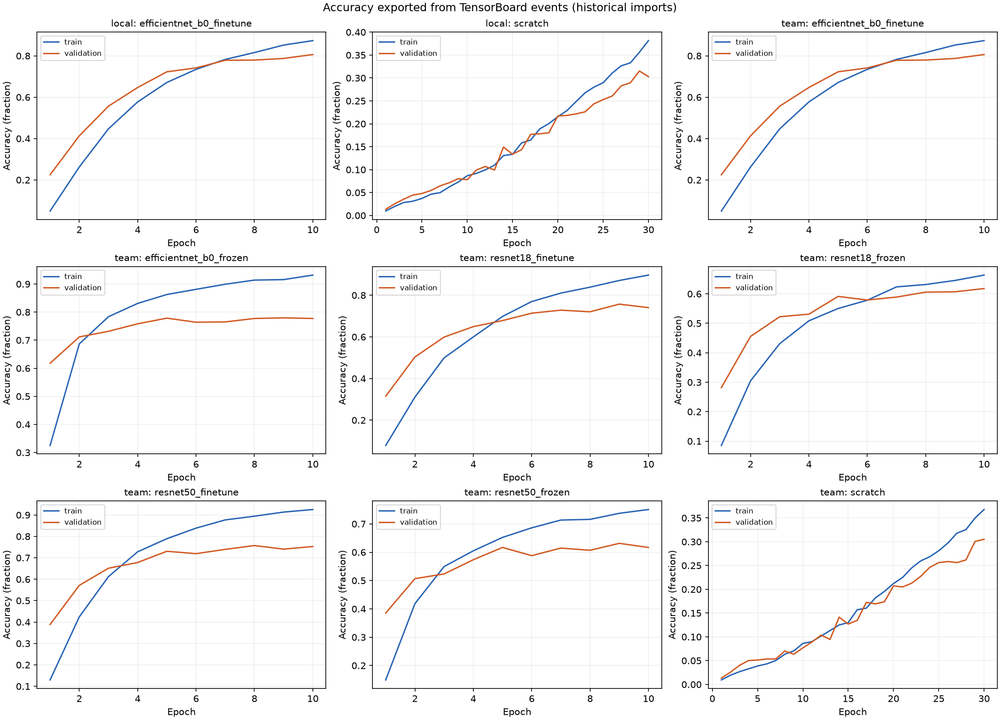
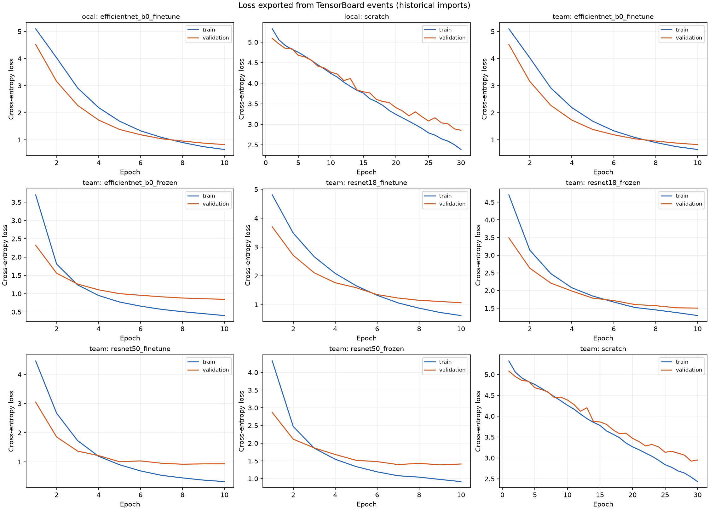

# Experiment tracking evidence

Generated from actual TensorBoard event files; curves are checked against the original saved histories.

- Real result records audited: **9**.
- Checkpoints verified against their referenced result records: **2**.
- Records with unavailable/invalid original weights: **7**.
- Source JSON files are preserved; SHA-256 values identify the exact inputs and weights.
- Matching names, settings, or scores do not establish that a rerun is an original run.

| Source | Curves | Configuration | Best metric | HParams | Weights |
|---|---|---|---|---|---|
| `outputs/my_training/tables/transfer_runs/efficientnet_b0_finetune.json` | verified | verified | verified | present | verified |
| `outputs/my_training/tables/transfer_runs/scratch.json` | verified | verified | verified | present | verified |
| `outputs/tables/transfer_runs/efficientnet_b0_finetune.json` | verified | verified | verified | present | missing |
| `outputs/tables/transfer_runs/efficientnet_b0_frozen.json` | verified | verified | verified | present | missing |
| `outputs/tables/transfer_runs/resnet18_finetune.json` | verified | verified | verified | present | missing |
| `outputs/tables/transfer_runs/resnet18_frozen.json` | verified | verified | verified | present | missing |
| `outputs/tables/transfer_runs/resnet50_finetune.json` | verified | verified | verified | present | missing |
| `outputs/tables/transfer_runs/resnet50_frozen.json` | verified | verified | verified | present | missing |
| `outputs/tables/transfer_runs/scratch.json` | verified | verified | verified | present | missing |

## Files

- `coverage.csv`: run-by-run checks, missing-weight reasons, and hashes.
- `run_settings.csv`: original hyperparameters for comparison.
- `tracking_events.json`: exported curves, text, and HParams read from TensorBoard.
- `checkpoint_inventory.json`: verified checkpoint metadata, labels, size, and SHA-256.

## Recovery procedure

For each missing historical run, obtain its original checkpoint from the teammate's training environment or model storage. Put it in `models/` and add its exact `checkpoint_path` to that run's JSON. Keep a provenance note from the owner; do not attach a new rerun's weights to an old history. Reimport tracking and rerun this export. Metadata checks reject setting/epoch/score mismatches; matching metadata alone is not proof of historical provenance. New training is recorded separately.

## Scope

These are historical imports, not live tracking captured during the original training. They expose only values present in the source histories; missing old checkpoints, learning-rate schedules, or unrecorded metrics are not reconstructed. Checkpoints are Git-ignored and must be shared separately. Evidence exports do not include the weight tensors.
